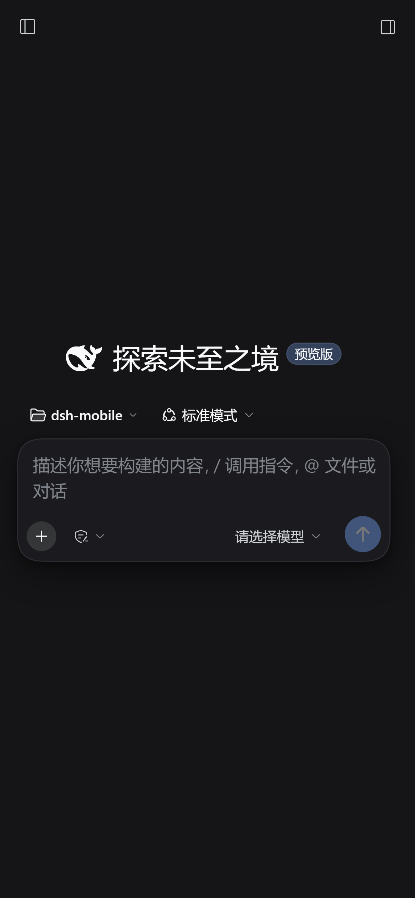

# DeepSeek Harness Mobile（非官方）

基于 [DeepSeek Harness](https://github.com/deepseek-ai/deepseek-harness) 的 Android / HarmonyOS 客户端工程。运行真实的 Node.js Host、加载官方编译前端，保留工作区、插件、工具调用与会话系统，只做移动端外壳与布局适配。

> 本项目为第三方学习项目，与 DeepSeek 官方无隶属、赞助或背书关系。「DeepSeek」名称与鲸鱼标识归其权利人所有，请勿用于商业分发。



## 特性

- **真实 Node 引擎**：Android 端启动 DSH 官方 Node Host，WebView 加载 `http://127.0.0.1:3080`。
- **精简运行时**：从 742 MB 压到约 331 MB，移除 LaTeX、OpenJDK、clang/LLVM、LibreOffice wasm、文档/CMake/Ghostscript 等。
- **移动端适配**：`< 768px` 使用官方原生抽屉；输入卡 28px 圆角、深色悬浮、安全区适配。
- **遮罩修复**：关闭官方 `.drawerMask` 的 `backdrop-filter`，固定唯一 mask 的 z-index，并清理重复节点，修复 iQOO 上的“双重黑遮罩”。
- **DeepSeek Harness 皮肤**：应用名、黑底白色 `>_` 自适应图标、纯黑启动页。
- **容器可诊断**：启动前 `chmod 0755`；日志写入 `Android/data/app.kxxy/files/engine_debug.log`，包含 ABI/厂商/型号/fork/spawn 错误。

## 目录

```
dsh-mobile/
├─ refer/DSH-Kxxy/          Android 工程与打包脚本
│  ├─ android/              Gradle 工程（assets/inject 为移动端注入）
│  └─ tools/build-apk.ps1   Gradle → 注入 runtime → zipalign → 签名
├─ harmony-app/             HarmonyOS Stage/ArkTS + NAPI(dlopen libnode.so)
├─ docs/preview/            390px 预览截图
├─ build.cmd                仅执行 Gradle 的快捷入口
└─ README.md
```

## Android 构建

### 环境

- JDK 17
- Android SDK：`platforms;android-36`、`build-tools;36.0.0`、`ndk;28.2.13676358`、`cmake;3.22.1`
- Node.js 24+、Python 3.12（生成运行时）
- 一台安装了 DSH Desktop 的机器（提供 `resources/app.asar`）

把 `refer/DSH-Kxxy/android/local.properties` 的 `sdk.dir` 指向 SDK。

### 1. 生成精简运行时

`runtime.zip` 与 `alias-links.txt` 是构建产物，不入库。在 `refer/DSH-Kxxy` 下：

```powershell
node tools/fetch-runtime.mjs
python tools/lib/debextract.py --debs .cache\debs --out .cache\stage
node --max-old-space-size=8192 tools/build-runtime.mjs --slim `
  --asar "C:\path\to\DSH Desktop\resources\app.asar"
```

产物默认写到 `android/app/src/main/assets/runtime.zip` 与 `alias-links.txt`。

### 2. 打包 APK

```powershell
cd refer\DSH-Kxxy
powershell -NoProfile -ExecutionPolicy Bypass -File tools\build-apk.ps1
```

产物：`refer/DSH-Kxxy/android/app/build/outputs/apk/debug/app-signed.apk`。

> 仓库自带固定签名密钥仅用于本项目 sideload 升级连续性，请勿用于其他应用或正式发布。

## HarmonyOS 当前状态

`harmony-app/` 是 Stage 模型 ArkTS 工程，NAPI 通过 `dlopen("libnode.so")` + `dlsym("_ZN4node5StartEiPPc")` 在 detached thread 调用 `node::Start`，`Web` 组件加载 `127.0.0.1:3080` 并注入同一份 `inject.js/css`。

**当前没有可直接安装的 HAP。** 仓库不包含 `libnode.so` / `libc++_shared.so`；需要：

1. 用 OpenHarmony NDK 把 Node 24 构建成 arm64 `--shared` 库，确认 `ET_DYN` 且导出 `_ZN4node5StartEiPPc`。
2. 把 `libnode.so`、`libc++_shared.so` 放进 `harmony-app/entry/libs/arm64-v8a/`。
3. 在 DevEco Studio 5.x（API 12+）中打开 `harmony-app`，配置签名后执行 `hvigorw assembleHap`。

也可使用 `.github/workflows/harmony-build.yml` 的 self-hosted `harmonyos` runner。详细步骤与限制见 [harmony-app/README.md](harmony-app/README.md)。

> 鸿蒙卓易通会拦截 `fork`/`clone`（`errno=13`）；进程内 `dlopen` 方案尚未在真机验证，且依赖子进程的终端工具在纯 seccomp 容器中仍不可用。

## API Key

应用**不包含、不硬编码任何密钥**。安装后进入官方前端，在「设置 → 模型服务」中手动填入你自己的 DeepSeek API Key。HarmonyOS 版本同样在 Web UI 内填写。

## 已知限制

- 仅打包 `arm64-v8a`。
- 精简版移除了 LaTeX、Java 编译、clang/LLVM、LibreOffice，相关能力不可用。
- HarmonyOS 版需要自行构建 `libnode.so`；无预编译 HAP。
- 鸿蒙容器可能限制私有目录 `execve`/`fork`；`engine_debug.log` 会记录具体 errno。

## 免责声明

仅供学习与个人使用。请遵守 DeepSeek 服务条款，不要将内置品牌资源用于商业分发、绕过服务限制或其他违规用途；由此产生的一切后果由使用者自行承担。
